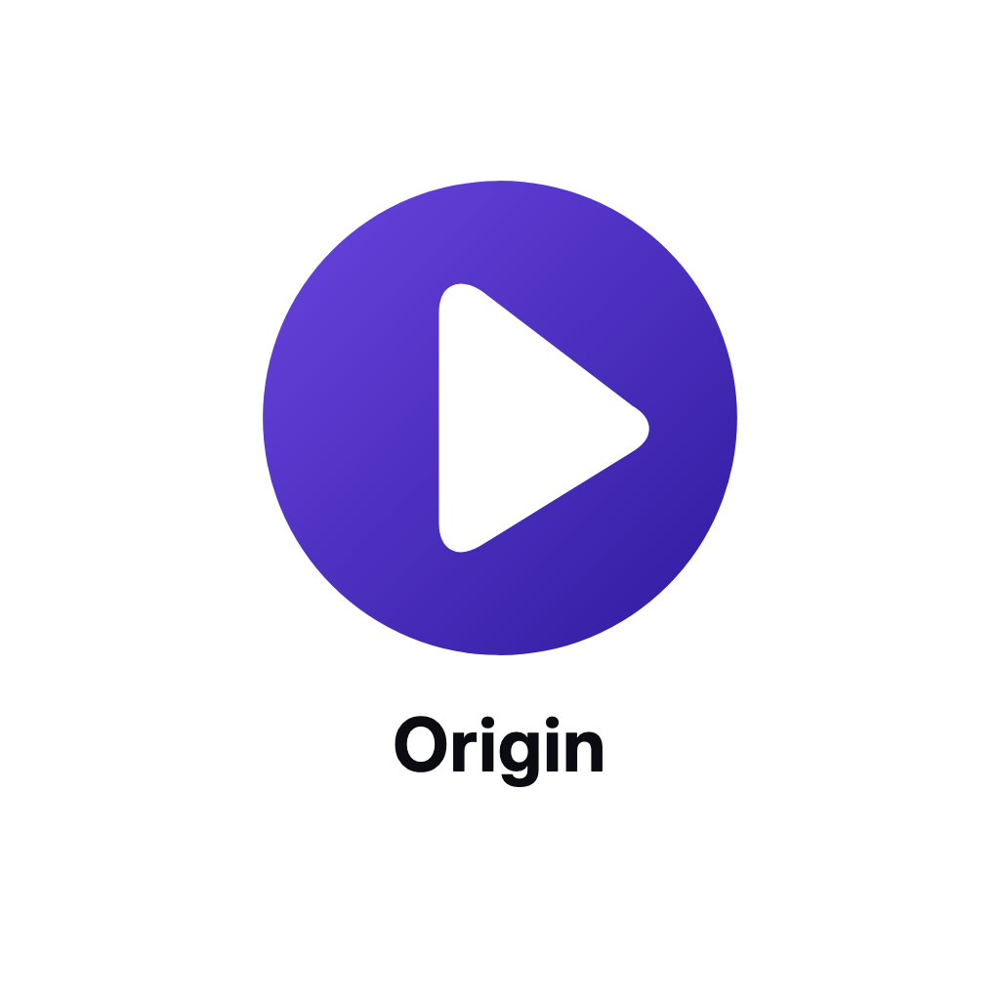

<h1 align="center">Stremio Origin</h1>

Native apps for Stremio addons, written in C.

<a href="https://stremioorigin.com">stremioorigin.com</a>

<em>Stremio™ is a trademark of its owner. Stremio Origin is independent and unofficial, and is not affiliated with, endorsed by or sponsored by Stremio.</em>

You bring your own Stremio account and your own addons. The apps ship empty and play only the stream links your addons return.

## Apps
| Platform | Status |
|---|---|
| [LG webOS](https://github.com/stremio-origin/webos) | Available |
| [Samsung](https://github.com/stremio-origin/tizen) | Available |
| [Android TV](https://github.com/stremio-origin/androidtv) | Available |
| [Android phone and tablet](https://github.com/stremio-origin/android-phone) | Available |
| iOS | In the works |
| Windows | Planned |
| macOS | Planned |

Each app has its own repository here, with its install guide and releases.

## Support
-  Support the project / Request a feature: [Ko-fi](https://ko-fi.com/simussu) 
-  [Discord](https://discord.gg/SJEtyV3kW6)
